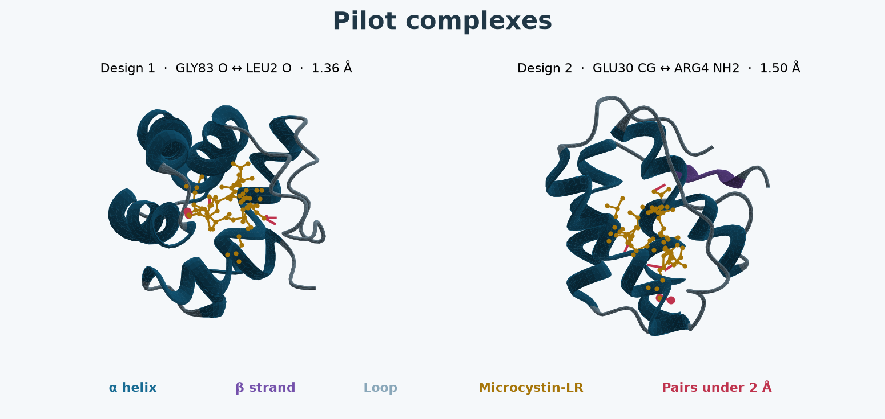
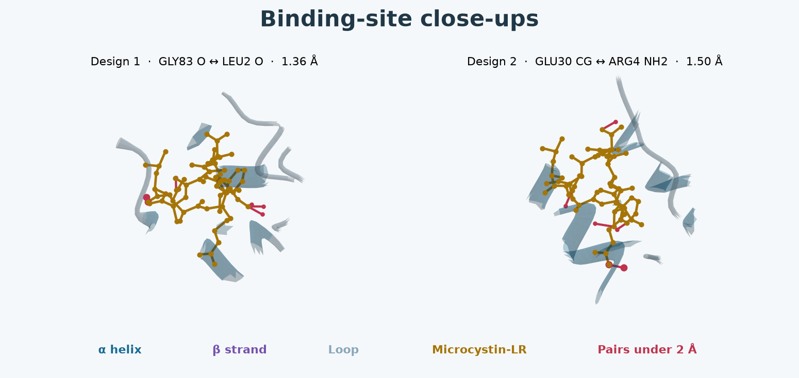
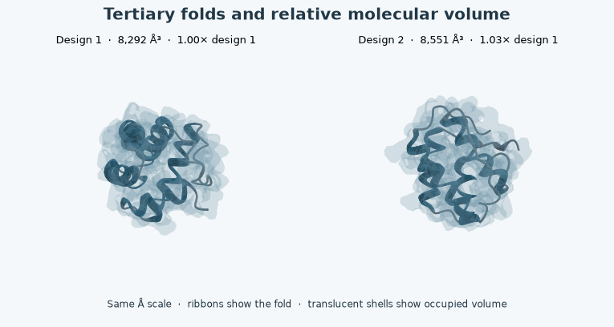
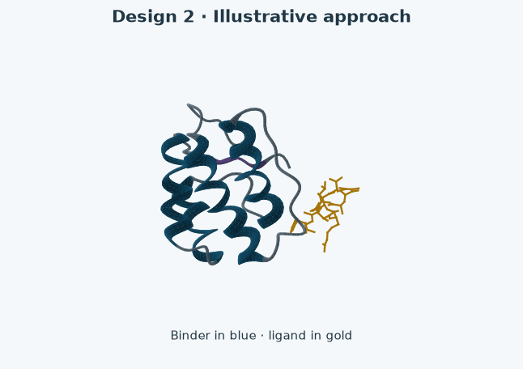

# Proteina-Complexa pilot with 1LCM

[Open both complexes in PyMOL](proteina-pilot.pse)

Both designs place microcystin-LR against a mostly helical fold. Each predicted pose has five protein–ligand heavy-atom pairs closer than 2 Å, including at least one backbone oxygen. The two poses need structural validation before experimental prioritization.





Each view is oriented to expose the ligand and the short contacts. The close-ups show only the nearby portions of the ribbon, drawn faintly to keep the ligand visible.

| Design | Secondary structure | Approx. protein volume | Closest protein–ligand pair |
|---|---|---:|---|
| Design 1 | 69 helical residues | 8,292 ų | Gly83 O ↔ ligand Leu2 O, **1.36 Å** |
| Design 2 | 59 helical residues, 4 β-strand residues | 8,551 ų | Glu30 Cγ ↔ ligand Arg4 NH₂, **1.50 Å** |

Design 2 occupies about **3.1% more volume**. Both folds are shown at the same Å scale. The volumes estimate the union of heavy-atom van der Waals spheres on a 0.55 Å grid. They describe the whole protein. Assessing fit requires local pocket shape and clash checks, and assessing binding requires an affinity measurement.

## Tertiary folds and molecular volume



[Still comparison](tertiary-volume.png)

## Ligand approach



The camera pans through 65° around the pocket and keeps rotating after the ligand reaches the predicted pose. The ligand follows an illustrative straight-line displacement, and the red marks identify the five short contacts in the final pose. The animation is a geometric illustration of the predicted complex.

## Interactive structures in PyMOL

Download the [PyMOL session](proteina-pilot.pse) and open it in PyMOL. Choose **Design 1** or **Design 2** in the scene list. The ligand is gold, and red dashes mark protein–ligand distances below 2 Å.

To rebuild the session, run the [PyMOL script](pilot.pml) from this folder and save the session in PyMOL.

## Original structures and reproduction

- **Design 1** · [Complex](structures/job_0_n_100_id_0_single_orig0/job_0_n_100_id_0_single_orig0.pdb) · [Isolated protein](structures/job_0_n_100_id_0_single_orig0/job_0_n_100_id_0_single_orig0_binder.pdb)
- **Design 2** · [Complex](structures/job_0_n_100_id_1_single_orig0/job_0_n_100_id_1_single_orig0.pdb) · [Isolated protein](structures/job_0_n_100_id_1_single_orig0/job_0_n_100_id_1_single_orig0_binder.pdb)

```bash
python -m pip install numpy scipy matplotlib pillow biotite scikit-image
python render_pilot.py
```

The [pilot README](README.md) covers RCP inference.
